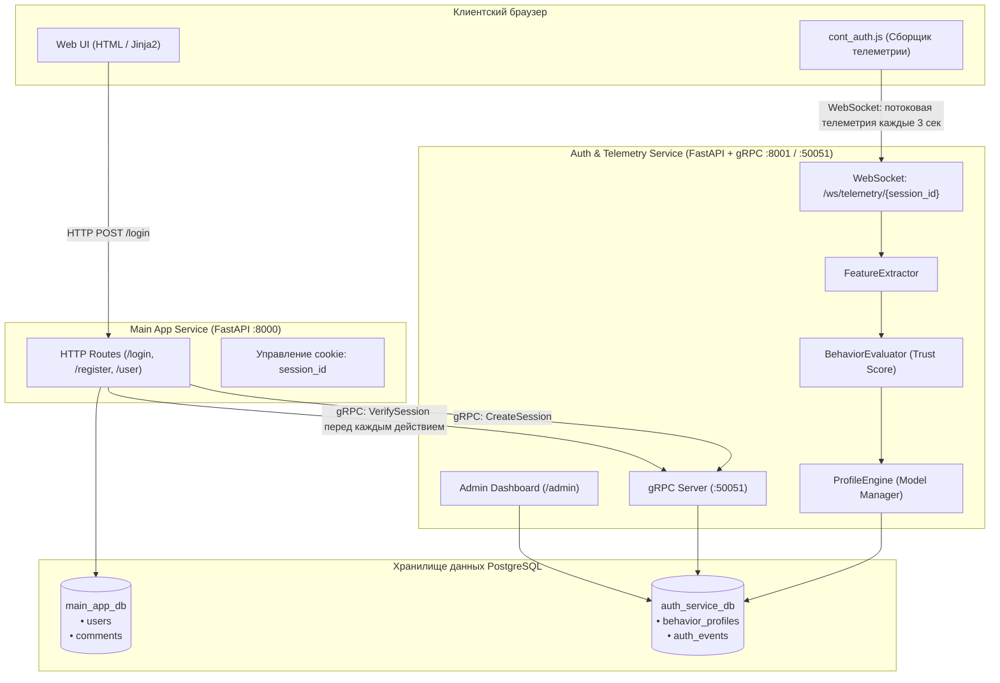

# 🛡️ Continuous Behavioral Authentication System
> **Система непрерывной поведенческой аутентификации на основе анализа биометрии пользователя (Zero-Trust Continuous Authentication)**

Данный репозиторий представляет собой распределённую систему непрерывной аутентификации (Continuous Authentication), реализующую концепцию **Zero Trust**. В отличие от классической модели аутентификации, где проверка подлинности пользователя происходит однократно (при вводе логина и пароля), данная система пассивно анализирует динамику поведения пользователя (движения курсора мыши, клики, динамику нажатия клавиш) на протяжении всей активной сессии в веб-приложении.

При фиксации аномалий или несоответствия эталонному поведенческому профилю показатель доверия (**Trust Score**) автоматически снижается, что активирует ступенчатую систему безопасности: от требования повторного ввода пароля до аннулирования сессии и блокировки IP-адреса нарушителя.

---

## 📑 Содержание
1. [Архитектура системы](#-архитектура-системы)
2. [Ключевые возможности и механизмы безопасности](#-ключевые-возможности-и-механизмы-безопасности)
3. [Поведенческая биометрия и статистический скоринг](#-поведенческая-биометрия-и-статистический-скоринг)
4. [Стек технологий](#-стек-технологий)
5. [Структура репозитория](#-структура-репозитория)
6. [Схема баз данных](#-схема-баз-данных)
7. [Протоколы и межсервисное взаимодействие](#-протоколы-и-межсервисное-взаимодействие)
8. [Установка и запуск](#-установка-и-запуск)
9. [Сценарии автоматического тестирования](#-сценарии-автоматического-тестирования)
10. [Панель администратора](#-панель-администратора)
11. [Точки расширения и математические модели](#-точки-расширения-и-математические-модели)

---

## 🏛 Архитектура системы

Система построена по микросервисной архитектуре с разделением ответственности и независимыми хранилищами данных:



### Основные компоненты:
1. **Main App (`main_app.py`)**:
   - Веб-приложение на FastAPI (порт `8000`), предоставляющее пользовательский интерфейс: регистрация, вход, профили пользователей, публикация комментариев.
   - Выступает в роли gRPC-клиента для взаимодействия с сервисом аутентификации.
   - Перед обработкой защищённых запросов валидирует валидность текущей сессии через gRPC-вызов `VerifySession`.
2. **Auth Service (`auth_service.py`)**:
   - Сервис аутентификации и аналитики телеметрии, совмещающий **gRPC-сервер** (порт `50051`) и **FastAPI HTTP/WebSocket-сервер** (порт `8001`).
   - Принимает телеметрию браузера через WebSocket в реальном времени.
   - Извлекает поведенческие признаки, производит скоринг доверия (Trust Score) и управляет жизненным циклом сессий.
   - Предоставляет интерактивную панель администратора (`/admin`).
3. **Telemetry Collector (`static/cont_auth.js`)**:
   - Клиентский скрипт, пассивно собирающий события манипулятора мыши (`mousemove`, `mousedown`, `mouseup`) и клавиатуры (`keydown`, `keyup`).
   - Выполняет локальный троттлинг событий, буферизацию и отправку пакетов через WebSocket каждые 3 секунды.
4. **PostgreSQL**:
   - Изолированные базы данных: `main_app_db` (бизнес-логика приложения) и `auth_service_db` (профили поведения и аудит безопасности).

---

## 🔒 Ключевые возможности и механизмы безопасности

### 1. Непрерывная аутентификация (Continuous Authentication)
Сессия пользователя не является безусловно доверенной. На протяжении всей работы в системе вычисляется метрика **Trust Score** в диапазоне от `0.0` до `1.0` (начальное значение — `1.0`). Если поведение пользователя перестаёт соответствовать профилю, метрика снижается.

### 2. Ступенчатая система реагирования (Stepped Security Enforcement)
* **Trust Score $\ge 0.4$ (Штатный режим)**: доступ ко всем функциям системы открыт, статус сессии — `STATUS_OK`.
* **Trust Score $< 0.4$ (Подозрительная активность)**:
  - Инкрементируется счётчик нарушений (`low_trust_count`).
  - При 1-м или 2-м нарушении статус сессии переводится в `STATUS_REAUTH_REQUIRED`. Соединение WebSocket закрывается с кодом `4001` (*Re-authentication required*). Пользователю требуется повторно подтвердить личность паролем.
* **Повторные нарушения (3 попытки)**:
  - При накоплении 3 нарушений срабатывает защита от компрометации: статус сессии переводится в `STATUS_IP_BLOCKED`.
  - IP-адрес клиента заносится в глобальный чёрный список (`BLOCKED_IPS`).
  - Соединение WebSocket разрывается с кодом `4003` (*IP Blocked*), все последующие попытки создания сессии и обращения к сервисам с этого IP отклоняются.

### 3. Политика единой активной сессии (Single-Session Policy)
В системе поддерживается привязка одного пользователя строго к одной активной сессии (`USER_SESSIONS`). При входе в систему с нового устройства или браузера предыдущая активная сессия того же пользователя автоматически инвалидируется со статусом `STATUS_REVOKED`.

### 4. Защита конфиденциальности в телеметрии
Клиентский скрипт `cont_auth.js` обезличивает вводимые символы: буквенно-цифровые клавиши заменяются абстрактным идентификатором `"char"`, сохраняя только физико-временные параметры (момент нажатия и отпускания клавиши), что исключает утечку чувствительных данных (паролей, персональных сообщений) через канал телеметрии.

---

## 🧠 Поведенческая биометрия и статистический скоринг

В `scoring.py` реализована архитектурная основа для вычисления Trust Score на базе прикладной математической статистики и поведенческой биометрии:

```
[Raw Events] ──> FeatureExtractor ──> [5 Biometric Features] ──> BehaviorEvaluator ──> [Trust Score] ──> ProfileEngine
```

1. **FeatureExtractor (Извлечение 5 биометрических признаков)**:
   - Анализирует сырой поток событий манипулятора мыши (`mm`, `md`, `mu`) и клавиатуры (`kd`, `ku`) за период пакетирования (батч).
   - Вычисляет 5 базовых биометрических признаков:
     1. `avg_mouse_speed`: средняя скорость курсора (пикс/мс).
     2. `std_mouse_speed`: стандартное отклонение скорости мыши внутри батча (пикс/мс).
     3. `avg_mouse_accel`: среднее абсолютное ускорение курсора (пикс/мс²).
     4. `avg_key_dwell`: среднее время удержания клавиши (Dwell Time, мс).
     5. `avg_key_flight`: среднее время перелёта между клавишами (Flight Time, мс).
2. **BehaviorEvaluator (3 статистических алгоритма оценки доверия)**:
   - `interval` — Метод интервальной оценки (правило $k$-сигм).
   - `mahalanobis` — Метод на основе многомерного расстояния Махаланобиса с ковариационной матрицей.
   - `cosine_dynamic` — Динамическое косинусное сходство с накоплением эталона через экспоненциальное скользящее среднее (EMA).
   - Возвращает обновлённый Trust Score сессии, а также скоры всех 3 методов для дашборда.
3. **ProfileEngine (Математическое построение эталонного профиля)**:
   - На этапе накопления истории (первые 500 событий) профиль пользователя имеет статус `"learning"`.
   - По достижении достаточного объема метрик профиль переходит в защищённый статус `"protected"`.
   - Непрерывно обновляет средние векторы, матрицу ковариации и EMA-вектор в PostgreSQL в поле `features` типа `JSONB`.

---

## 🛠 Стек технологий

* **Язык программирования**: Python 3.10+
* **Веб-фреймворк**: [FastAPI](https://fastapi.tiangolo.com/), [Starlette](https://www.starlette.io/), [Uvicorn](https://www.uvicorn.org/)
* **Межсервисный транспорт**: [gRPC](https://grpc.io/), [Protocol Buffers (proto3)](https://protobuf.dev/)
* **Потоковая передача данных**: WebSockets (RFC 6455)
* **Базы данных и ORM**: [PostgreSQL](https://www.postgresql.org/), [SQLAlchemy 2.0](https://www.sqlalchemy.org/) (Async Engine), [asyncpg](https://github.com/MagicStack/asyncpg)
* **Шаблонизация и Frontend**: Jinja2, [HTMX](https://htmx.org/) (для дашборда администратора), нативный Vanilla JavaScript, CSS3
* **Тестирование**: `asyncio`, `websockets`, `grpcio`

---

## 📁 Структура репозитория

```text
auth_test_gemini/
├── auth.proto                   # gRPC Protobuf-спецификация сервиса аутентификации
├── auth_pb2.py                  # Скомпилированные Protobuf-классы сообщений
├── auth_pb2_grpc.py             # Скомпилированные классы gRPC клиента и сервера
├── auth_models.py               # SQLAlchemy модели БД auth_service_db
├── auth_service.py              # Микросервис аутентификации (FastAPI + gRPC + WebSocket + Admin)
│
├── main_models.py               # SQLAlchemy модели БД main_app_db
├── main_app.py                  # Основной веб-сервис приложения (FastAPI :8000)
├── main.py                      # Оркестратор запуска обоих микросервисов
├── main_clear.py                # Скрипт очистки истории скоринга и запуска сервисов
├── init_db.py                   # Автоматическое создание баз данных и таблиц PostgreSQL
├── PostgreCreateTables.txt      # Исходные SQL DDL-скрипты для ручного создания таблиц
│
├── static/                      # Статические файлы основного приложения
│   ├── cont_auth.js             # Клиентский трекер поведенческой телеметрии
│   └── styles.css               # Таблицы стилей
├── templates/                   # Шаблоны основного приложения (Jinja2)
│   ├── login.html               # Страница входа
│   ├── register.html            # Страница регистрации
│   └── profile.html             # Профиль пользователя и комментирование
│
├── auth_templates/              # Шаблоны сервиса аутентификации
│   └── admin.html               # Дашборд администратора реального времени (HTMX)
│
├── test_low_trust.py            # Автоматизированный end-to-end тест сценариев безопасности
├── requirements.txt             # Список зависимостей Python
└── README.md                    # Документация проекта
```

---

## 🗄 Схема баз данных

В архитектуре используются две независимые базы данных PostgreSQL:

### 1. `main_app_db` (Бизнес-логика приложения)

* **`users`**:
  * `uuid` (`UUID`, PK) — уникальный идентификатор пользователя.
  * `login` (`VARCHAR(255)`, UNIQUE, NOT NULL) — логин.
  * `password` (`VARCHAR(255)`, NOT NULL) — пароль.
  * `created_at` (`TIMESTAMP`) — дата регистрации.
* **`comments`**:
  * `id` (`SERIAL`, PK) — идентификатор комментария.
  * `target_user_login` (`VARCHAR(255)`, FK $\to$ `users.login`) — получатель комментария.
  * `author_login` (`VARCHAR(255)`) — автор комментария.
  * `text` (`TEXT`) — текст комментария.
  * `created_at` (`TIMESTAMP`) — время публикации.

### 2. `auth_service_db` (Сервис аутентификации и аналитики)

* **`behavior_profiles`**:
  * `username` (`VARCHAR`, PK) — логин пользователя.
  * `features` (`JSONB`) — структурированный профиль поведения (статус обучения, количество накопленных событий, негативные события).
  * `updated_at` (`TIMESTAMP`) — время последнего обновления профиля.
* **`auth_events`**:
  * `id` (`SERIAL`, PK) — идентификатор события.
  * `username` (`VARCHAR`, NOT NULL) — пользователь.
  * `score` (`DOUBLE PRECISION`) — вычисленный Trust Score.
  * `decision` (`BOOLEAN`) — решение системы (успешно / отказ в доверии).
  * `ts` (`TIMESTAMP`) — метка времени события.

---

## 📡 Протоколы и межсервисное взаимодействие

### 1. gRPC Контракт (`auth.proto`)
Сервис `AuthService` предоставляет 4 RPC-метода:

```protobuf
syntax = "proto3";
package auth;

enum SessionStatus {
    STATUS_OK = 0;
    STATUS_REAUTH_REQUIRED = 1;
    STATUS_REVOKED = 2;
    STATUS_IP_BLOCKED = 3;
}

service AuthService {
    rpc CreateSession (CreateSessionRequest) returns (CreateSessionResponse);
    rpc VerifySession (VerifySessionRequest) returns (VerifySessionResponse);
    rpc Reauthenticate (ReauthenticateRequest) returns (ReauthenticateResponse);
    rpc Logout (LogoutRequest) returns (LogoutResponse);
}
```

### 2. WebSocket Телеметрия (`/ws/telemetry/{session_id}`)
Клиент раз в 3 секунды отправляет JSON-пакет следующей структуры:
```json
{
  "sequence_id": 4,
  "batch_timestamp": 1751457800000,
  "events": [
    { "t": "mm", "ts": 1751457798100, "x": 512, "y": 384 },
    { "t": "md", "ts": 1751457798500, "x": 512, "y": 384, "btn": 0 },
    { "t": "mu", "ts": 1751457798600, "x": 512, "y": 384, "btn": 0 },
    { "t": "kd", "ts": 1751457799000, "key": "char" },
    { "t": "ku", "ts": 1751457799080, "key": "char" }
  ]
}
```

Коды завершения WebSocket-соединения:
* `1008`: Сессия аннулирована (вход с другого устройства или истечение срока).
* `4001`: Требуется повторная аутентификация (Trust Score упал ниже `0.4`).
* `4003`: Доступ заблокирован на уровне IP-адреса.

---

## 🚀 Установка и запуск

### 1. Системные требования
* **Python** версии 3.10 или выше.
* **PostgreSQL** версии 14 или выше.

### 2. Клонирование и настройка виртуального окружения
```bash
git clone <URL_РЕПОЗИТОРИЯ>
cd auth_test_gemini

# Создание виртуального окружения
python -m venv .venv

# Активация окружения (Windows PowerShell)
.venv\Scripts\Activate.ps1
# Или в Linux / macOS:
# source .venv/bin/activate
```

### 3. Установка зависимостей
```bash
pip install -r requirements.txt
pip install grpcio grpcio-tools websockets
```

*(Опционально)* Если вы изменяете `auth.proto`, пересоберите gRPC-файлы:
```bash
python -m grpc_tools.protoc -I. --python_out=. --grpc_python_out=. auth.proto
```

### 4. Настройка PostgreSQL и инициализация таблиц
Убедитесь, что сервер PostgreSQL запущен на `localhost:5432` с пользователем `postgres` и паролем `postgres` (или скорректируйте параметры подключения в `init_db.py`, `main_app.py` и `auth_service.py`).

Запустите скрипт автоматического создания баз данных и таблиц:
```bash
python init_db.py
```
Скрипт автоматически создаст базы данных `main_app_db` и `auth_service_db`, а также сгенерирует необходимые таблицы через SQLAlchemy.

---

### 5. Запуск системы

#### Вариант А: Единый запуск (Рекомендуемый)
Для запуска обоих микросервисов одной командой используйте скрипт оркестрации:
```bash
python main.py
```
Скрипт запустит:
* `Auth Service` на `http://0.0.0.0:8001` (HTTP/WS) и `localhost:50051` (gRPC).
* `Main App` на `http://0.0.0.0:8000`.

#### Вариант Б: Запуск со сбросом профилей и событий
Если требуется сбросить историю скоринга и вернуть все профили в режим `"learning"` перед стартом:
```bash
python main_clear.py
```

#### Вариант В: Ручной раздельный запуск
В двух отдельных терминалах:
```bash
# Терминал 1: Сервис аутентификации
uvicorn auth_service:app --host 0.0.0.0 --port 8001 --reload

# Терминал 2: Основное приложение
uvicorn main_app:app --host 0.0.0.0 --port 8000 --reload
```

---

## 🧪 Сценарии автоматического тестирования

В репозитории присутствует автономный сценарий комплексного тестирования безопасности: [`test_low_trust.py`](test_low_trust.py).

Скрипт эмулирует действия клиента и последовательно проверяет:
1. Создание сессии через gRPC и проверку исходного статуса (`STATUS_OK`).
2. Отправку аномального пакета телеметрии с искусственным занижением Trust Score до `0.2`.
3. Корректный разрыв WebSocket-соединения со стороны сервера с кодом `4001` (*Re-authentication required*).
4. Проверку статуса сессии через gRPC `VerifySession` (`STATUS_REAUTH_REQUIRED`).
5. Прохождение повторной аутентификации по паролю (`Reauthenticate`) и сброс Trust Score обратно до `1.0`.
6. Симуляцию серии из 3 последовательных аномальных нарушений.
7. Проверку автоматического занесения клиента в глобальный IP-бан (`STATUS_IP_BLOCKED`).

### Запуск теста:
Убедитесь, что серверы запущены (`python main.py`), затем выполните в отдельном окне:
```bash
python test_low_trust.py
```

---

## 📊 Панель администратора

Сервис аутентификации оснащён встроенным веб-дашбордом для операторов безопасности:
* **URL**: `http://localhost:8001/admin`

**Возможности дашборда:**
* **Выбор активного алгоритма скоринга**: переключение между 3 математическими моделями (`interval`, `mahalanobis`, `cosine_dynamic`) в реальном времени.
* **Active Sessions (Активные сессии)**: отслеживание подключенных пользователей, их IP-адресов, текущего значения Trust Score с цветовой шкалой и одновременным отображением оценок всех 3 алгоритмов.
* **Behavioral Profiles (Поведенческие профили)**: состояние накопления эталона по каждому пользователю (`learning` / `protected`), количество собранных событий, счётчик аномалий и кнопка ручного бенчмарк-тестирования нелегитимного бота ("⚡ Тест бота").
* **Authentication Audit Log (Аудит-лог)**: хронологический лог всех событий скоринга с решениями системы (`Allowed` / `Denied`).
* **HTMX Live-Refresh**: автоматическое обновление списков в фоновом режиме без полной перезагрузки страницы.

---

## 🔮 Точки расширения и математические модели

Архитектура проекта спроектирована для гибкого масштабирования математического скоринга:

1. **Расширение биометрического пространства (`FeatureExtractor`)**:
   - 5 ключевых признаков: `avg_mouse_speed`, `std_mouse_speed`, `avg_mouse_accel`, `avg_key_dwell`, `avg_key_flight`.
   - Векторные характеристики мыши: угловая скорость, кривизна траектории, рывок (Jerk).
2. **Алгоритмы скоринга (`BehaviorEvaluator`)**:
   - `interval`: Интервальная оценка по правилу $k$-сигм с экспоненциальным штрафом за границы интервала.
   - `mahalanobis`: Оценка многомерного расстояния Махаланобиса с регуляризацией ковариационной матрицы $\boldsymbol{\Sigma}$.
   - `cosine_dynamic`: Динамическое косинусное сходство векторов признаков с эталоном, адаптируемым через экспоненциальное скользящее среднее (EMA).
3. **Хранение эталонов**:
   - Поле `BehaviorProfile.features` (`JSONB`) в базе данных сохраняет математические ожидания, стандартные отклонения, ковариационные матрицы и динамические векторы EMA.
